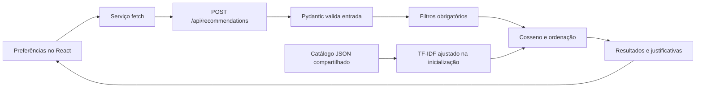

# FoodLab · FoodMatch AI

Aplicativo fictício de delivery com um recomendador de restaurantes baseado em conteúdo. Projeto de portfólio para estudar Python, Machine Learning, APIs e integração de modelos ao React.

O usuário informa culinária, orçamento estimado, prioridade e sabores desejados. O backend aplica filtros, calcula afinidade textual com TF-IDF e similaridade de cosseno e devolve opções ordenadas com justificativas verificáveis.

Não há vínculo com o iFood. Restaurantes, preços e avaliações são fictícios. Não há pedidos, pagamentos, autenticação ou entregas reais.

## Executar no Windows

Ambiente validado: **Python 3.15.2**, Node.js 22.12+ e npm. Execute os comandos a partir da pasta que contém este README.

Primeira instalação:

```powershell
npm.cmd ci
py -3.15.2 -m venv .venv
.\.venv\Scripts\python.exe -m pip install -r backend/requirements-lock.txt
npm.cmd run build
npm.cmd start
```

Abra **http://127.0.0.1:8000**. Esse modo serve frontend e API no mesmo processo e endereço. Encerre com `Ctrl+C`. Não é necessário ativar o ambiente virtual no PowerShell.

Se as dependências e o build já estiverem disponíveis, basta `npm.cmd start`. Depois de alterar o React, execute `npm.cmd run build` novamente para atualizar a versão servida.

`requirements-lock.txt` fixa todas as versões testadas, incluindo as ferramentas de teste. `requirements.txt` declara apenas dependências diretas de execução; `requirements-dev.txt` acrescenta testes. A pasta `.venv` não deve ser copiada entre computadores nem versionada.

### Desenvolvimento com atualização automática

Terminal 1:

```powershell
npm.cmd run api
```

Terminal 2:

```powershell
npm.cmd run dev
```

Abra o endereço exibido pelo Vite, normalmente http://127.0.0.1:5173. O Vite encaminha `/api` para `127.0.0.1:8000`. No modo completo, FastAPI serve `dist/` e resolve as rotas do React Router. A documentação interativa da API está em http://127.0.0.1:8000/docs.

## Funcionalidades

- Catálogo local de 12 restaurantes, 8 categorias e 72 produtos.
- Home, busca sem distinção de acentos, categorias, filtros e ordenação.
- Detalhes e cardápios, favoritos no localStorage e layout responsivo.
- FoodMatch AI com formulário de culinária, orçamento, prioridade e texto livre.
- Requisição real ao backend, carregamento, cancelamento, timeout de 12 s, erro com nova tentativa e estado vazio.
- Recomendações com razões baseadas em categoria, estimativa de custo e termos compartilhados; sem explicações geradas por LLM.

## Como o recomendador funciona

1. Carrega e valida `src/data/restaurants.json` ao iniciar o backend.
2. Combina categoria, descrição e tags de cada restaurante em um documento.
3. Ajusta `TfidfVectorizer` uma vez no catálogo completo: minúsculas, remoção de acentos, pequena lista explícita de stop words em português, unigramas e bigramas e TF sublinear.
4. Valida a consulta com Pydantic.
5. Filtra por categoria exata quando escolhida e por `averagePrice + deliveryFee <= budget`. `null` remove o respectivo filtro.
6. Transforma o texto do usuário no mesmo vocabulário. Se não houver descrição, usa a categoria como consulta textual.
7. Calcula similaridade de cosseno; documentos com afinidade zero não entram quando há consulta reconhecida.
8. Combina afinidade, nota e prazo conforme a prioridade, com desempate determinístico.
9. Devolve até 6 resultados por padrão; a API permite de 1 a 12.

| Prioridade             | Afinidade | Nota normalizada | Rapidez normalizada |
| ---------------------- | --------: | ---------------: | ------------------: |
| Combinar com meu gosto |      0,85 |             0,10 |                0,05 |
| Melhor avaliação       |      0,60 |             0,35 |                0,05 |
| Entrega mais rápida    |      0,60 |             0,05 |                0,35 |

`nota = rating / 5`; `rapidez = 1 - min(deliveryMax, 90) / 90`. Pesos são heurísticos, não foram aprendidos ou otimizados com usuários. A prioridade aumenta o peso do critério, sem garantir que ele sozinho determine a ordem.

Sem texto reconhecido, o sistema declara o modo alternativo: por padrão, 80% nota e 20% rapidez; para prioridade de entrega, 80% rapidez e 20% nota. Não inventa similaridade. Se os filtros eliminarem todas as opções ou houver consulta reconhecida sem afinidade entre as elegíveis, devolve uma lista vazia.

## Arquitetura



```text
backend/
  schemas.py                 Modelos de entrada, catálogo e resposta
  catalog.py                 Leitura e validação do JSON
  recommender.py             TF-IDF, filtros, cosseno e ranking
  main.py                    FastAPI, lifespan, endpoints e servidor do frontend
  evaluate.py                Avaliação sintética contra baseline
  tests/                     Testes de regras, API e validação
  requirements*.txt          Dependências diretas e lock testado
src/
  components/FoodMatchForm.tsx     Coleta de preferências
  components/FoodMatchResults.tsx  Apresentação dos estados e resultados
  pages/FoodMatchPage.tsx          Controle da consulta, cancelamento e navegação
  services/recommendations.ts      Contrato HTTP e verificação da resposta
  types/foodmatch.ts               Tipos TypeScript
  data/restaurants.json           Fonte única do catálogo
scripts/serve.mjs             Inicia API ou aplicação completa usando .venv
exploracao/                  Exercícios originais do aprendizado, preservados
```

Rotas principais: `/`, `/restaurantes`, `/restaurantes/:id`, `/favoritos`, `/foodmatch`, `/foodmatch/resultados`.

## API

`GET /api/health` informa saúde, número de restaurantes e versão do modelo.

`POST /api/recommendations`:

```json
{
  "category": "Japonesa",
  "budget": 60,
  "description": "sushi salmão",
  "priority": "relevance",
  "limit": 6
}
```

Resposta: `items`, `total_eligible`, `mode`, `message` e `model`. Cada item inclui `restaurant`, `reason`, `similarity`, `score`, `estimated_cost` e `matched_terms`. Com esses critérios, Koji Sushi é elegível e Sushi Prime ultrapassa a estimativa de orçamento.

Orçamento deve ser numérico, positivo e até 10000, ou `null`; descrição tem até 500 caracteres; categoria e prioridade pertencem a conjuntos definidos; campos extras são rejeitados. Entrada inválida retorna 422. Nenhuma opção é um resultado 200 com `items: []`, não um erro do servidor. Endpoints desconhecidos retornam 404 JSON.

## Validação e avaliação

```powershell
npm.cmd run build
.\.venv\Scripts\python.exe -m pytest
.\.venv\Scripts\python.exe -m backend.evaluate
```

A avaliação compara o recomendador a um baseline de maior nota em quatro consultas sintéticas de culinária, sem filtro de categoria. Relevância foi definida pela categoria esperada de cada cenário. Resultado registrado em `docs/evaluation-results.json`: Precision@2 média de 1,00 para o recomendador e 0,125 para o baseline.

**Esse resultado é somente uma verificação sintética do pequeno catálogo.** As consultas repetem características presentes nos documentos. Não mede satisfação, generalização, qualidade semântica ou desempenho em produção; não representa “100% de acerto”. Veja [o relatório de validação](docs/VALIDACAO.md).

## Limitações

- TF-IDF compara palavras e expressões; não entende sinônimos, intenção, negação ou restrições alimentares de forma confiável.
- Categoria escolhida é um filtro obrigatório neste MVP. Texto livre descreve preferências positivas.
- Preço médio + entrega é uma estimativa, não o total de um carrinho. Pedido mínimo e produtos específicos não entram nesse cálculo.
- Nota, distância e prazos são valores fictícios estáticos. Não há disponibilidade ou localização em tempo real.
- Somente 12 restaurantes; não há dados reais de interação ou avaliação com usuários.
- Similaridade e score não são probabilidades de satisfação. Pesos e limite de prazo de normalização são escolhas explícitas de MVP.
- Favoritos não treinam o recomendador; apenas ficam salvos no navegador.
- Preferências e resultados ficam em memória no frontend e são perdidos ao recarregar ou sair da seção.
- Backend carrega o catálogo ao iniciar; reinicie após editar o JSON.
- Sem autenticação, rate limiting ou infraestrutura para publicação aberta. O servidor inicia somente em loopback para uso local.

## Documentação para estudo e portfólio

- [Explicação passo a passo, como uma aula](docs/GUIA-DIDATICO.md)
- [Resumo de mudanças e mensagem de commit](docs/RESUMO-GITHUB.md)
- [Preparação para Git/GitHub](docs/GITHUB.md)
- [Interface e integração](docs/foodmatch-interface.md)

A implementação final foi concluída com assistência de IA a pedido do autor. Os exercícios em `exploracao/` registram parte do aprendizado prévio. A documentação distingue o que foi implementado e testado das limitações ainda existentes.

## Créditos e referências

Fotos ilustrativas do Unsplash são arquivos locais em `public/images/`, reutilizados por categoria. IDs: burger `photo-1568901346375-23c9450c58cd`; sushi `photo-1579871494447-9811cf80d66c`; pizza `photo-1579751626657-72bc17010498`; salada `photo-1512621776951-a57141f2eefd`; comida caseira `photo-1547592180-85f173990554`; massa `photo-1473093295043-cdd812d0e601`; doce `photo-1578985545062-69928b1d9587`; taco `photo-1565299585323-38d6b0865b47`. As fotos não representam restaurantes reais com os nomes deste catálogo. Ícones [Lucide](https://lucide.dev), licença ISC.

Referências: [TfidfVectorizer](https://scikit-learn.org/stable/modules/generated/sklearn.feature_extraction.text.TfidfVectorizer.html), [similaridade de cosseno](https://scikit-learn.org/stable/modules/generated/sklearn.metrics.pairwise.cosine_similarity.html), [testes FastAPI](https://fastapi.tiangolo.com/tutorial/testing/), [React Router](https://reactrouter.com/start/declarative/installation) e [Tailwind com Vite](https://tailwindcss.com/docs/installation/using-vite).
